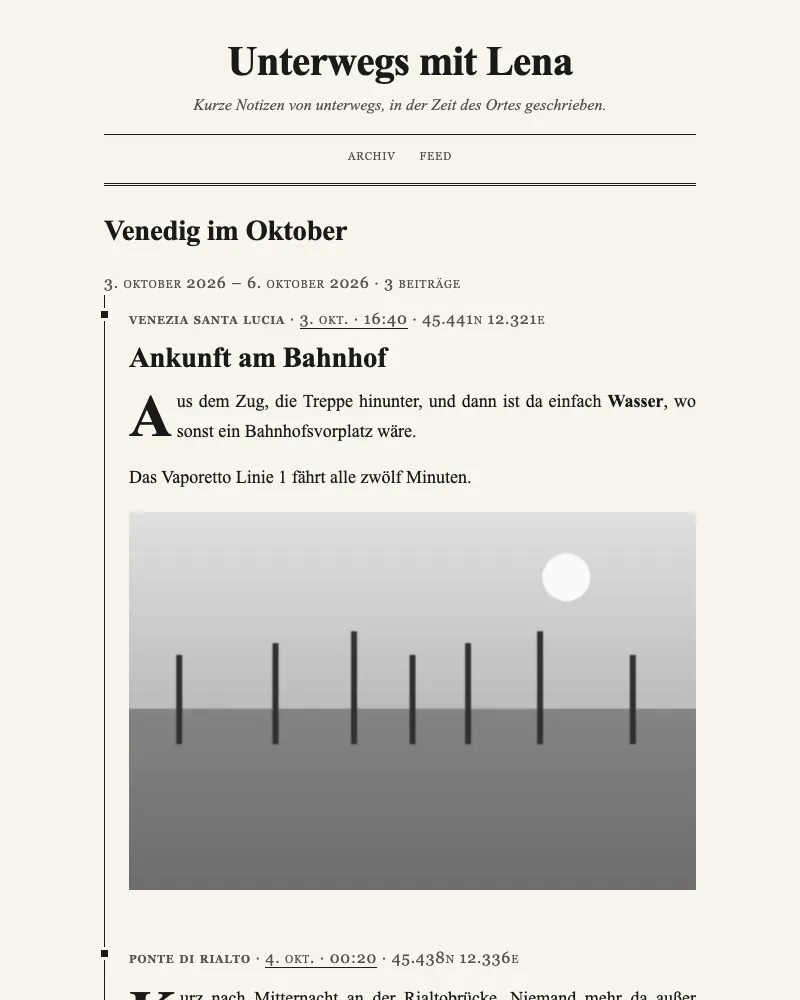
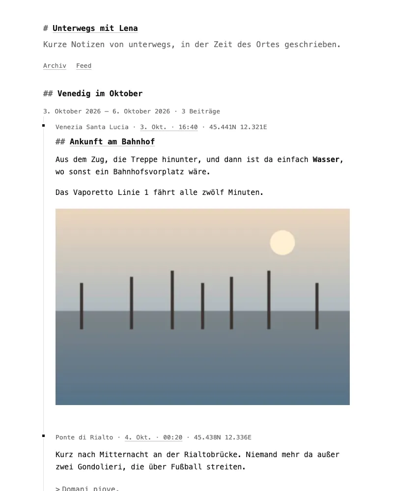
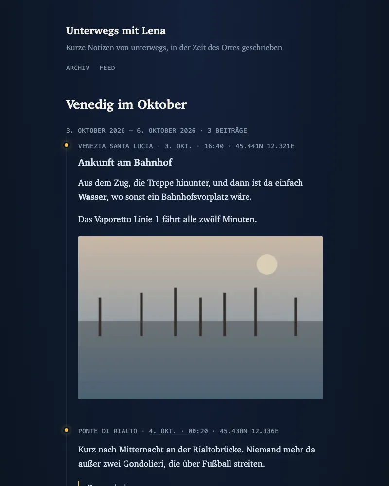
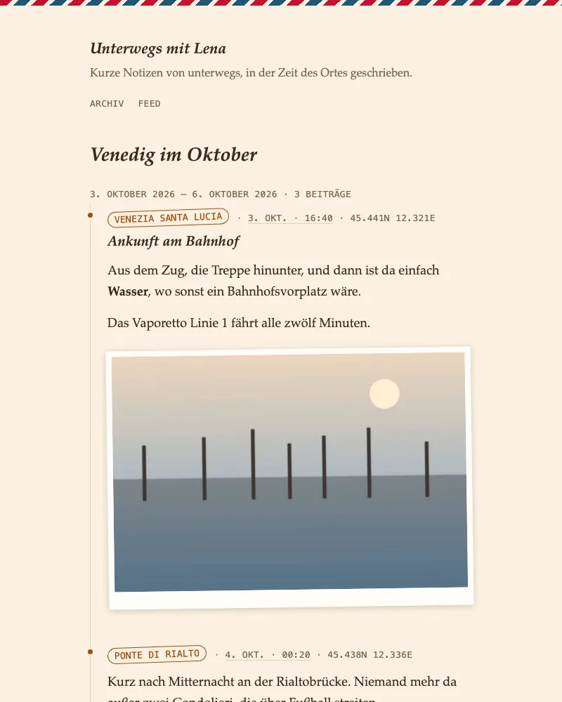

# Custom CSS for an Ortszeit blog

On the paid plan, an Ortszeit blog can carry its own CSS. It is added after
the theme's stylesheet, so it can change the colours, the fonts and the
layout without starting from nothing. This folder has four hand-written
examples. Each one passes Ortszeit's filter unchanged (apart from its
comments) and targets the blog's real markup.

| Sheet | Look | |
|---|---|---|
| [`zeitung.css`](zeitung.css) | A newspaper page: centred masthead between double rules, Times, small caps, justified text, drop caps, black-and-white photos. Light and dark. |  |
| [`mono.css`](mono.css) | Plain text: monospace throughout, black on white, underlined links, headings marked like Markdown. A quiet start for your own. Light and dark. |  |
| [`nacht.css`](nacht.css) | After dark, always: deep blue paper, moonlit text, lamp-yellow links and glowing route dots, photos dimmed until you point at them. |  |
| [`postkarte.css`](postkarte.css) | A card home: cream paper, brown ink, Palatino, an airmail stripe, the place in a postmark ring, photos as crooked prints. Light and dark. |  |

The screenshots show the trip page of the shared sample export, built with
[`../ssg/`](../ssg/) with the sheet as its custom CSS.

## Using one

1. Open the sheet, select everything and copy it.
2. In [Studio](https://studio.ortszeit.app/), open your blog's
   **Settings** (*Einstellungen*).
3. Paste it into **Custom CSS** (*Eigenes CSS*) and choose **Save
   settings** (*Einstellungen speichern*).
4. Open your blog. The new look is there on every page.

To go back, empty the field and save again. The field is there on the paid
plan; on the free plan Ortszeit keeps what you saved but does not use it.

To try a sheet before you paste it, preview it on the sample blog:

```sh
uv run custom-css/preview.py custom-css/zeitung.css
# open http://localhost:8000/venedig-2026/
```

`--export ~/Downloads/blog` previews it on your own (extracted) export
instead. The preview uses the static generator from `../ssg/`, which has the
same markup and base sheet as the hosted blog. The maps and the photo
lightbox are only on the hosted blog.

Your custom CSS is part of your [export][format] (`custom_css` in
`blog.yaml`), and the [`hugo/`](../hugo/) and [`astro/`](../astro/)
importers copy it into the new project. Their templates use the same classes
and tokens, so a sheet from here keeps working there. The site title there
is `.site .title` instead of `.site h1`; the sheets here name both.

## What Ortszeit removes

Ortszeit filters custom CSS before it reaches a page. The filter removes,
without trying to repair the rule around it:

- comments (`/* … */`): write them freely, readers never get them
- backslashes, so no CSS escapes such as `"\201C"`: type the character itself
- `<`, so the sheet cannot close its `<style>` element (media queries with
  `<` ranges are out too: write `max-width:` instead)
- `@import`, `@charset`, `@namespace` and whole `@font-face` blocks: the
  blog uses system fonts, and nothing is loaded from elsewhere
- `url(…)`, `image-set(…)` and `src(…)`: no background images, no tracking
  pixels, not even `data:` addresses. Gradients work.
- `expression(…)`, `behavior:` and `-moz-binding:`
- `position: fixed`, so nothing can lie over the page

The blog's Content-Security-Policy stops anything that got past the filter
from loading from another site. A sheet that needs none of these constructs
arrives exactly as written. `uv run custom-css/tests/test_stylesheets.py`
checks that for every sheet here.

## What to style

The colour and type tokens are custom properties on `:root`. Setting them is
often enough. The theme sets them again inside
`@media (prefers-color-scheme: dark)`, so a sheet that sets colours should do
the same (or set `color-scheme: dark` and one palette, as `nacht.css` does).

| Token | What it is |
|---|---|
| `--paper`, `--ink` | page background and text |
| `--muted` | the bio, the meta line, quotes |
| `--rule` | lines between posts, the route rule |
| `--accent` | the route dots |
| `--accent-strong` | links, focus rings, buttons |
| `--accent-dim` | link underlines |
| `--on-accent` | text on an `--accent-strong` button |
| `--ocean` | the second colour of the palette |
| `--shade` | the lightbox backdrop |
| `--font-body`, `--font-meta` | the text (serif) and the meta line (monospace) |
| `--measure` | the width of the column, 34rem |

The classes and elements:

| Selector | What it is |
|---|---|
| `.wrap`, `.wrap.route-wrap` | the column; a little wider on trip pages |
| `.site`, `.site h1`, `.bio`, `.site nav` | the header: title, bio, navigation |
| `main > h2:not(.meta)` | the title of a trip page |
| `.post`, `.post h1`, `.post h2` | one post, its title (h1 on its own page) |
| `.meta`, `.place`, `.meta time` | the line PLACE · DATE · TIME · COORDINATES, and its parts |
| `.body`, `.body p`, `.body blockquote` | the text of a post |
| `.photos.solo img` | a single photo, full width |
| `.photos.strip`, `.strip button`, `.strip img` | two or more photos as a strip of squares |
| `.route`, `.route .post::before` | the trip page's rule and its dots |
| `.stack`, `.stack .when`, `.year` | the archive's lists |
| `.site-footer`, `.credits` | the footer and the GeoNames credit |

Keep to these. Other class names on the blog are internal and may change.

## Licence

MIT, see [`LICENSE`](../LICENSE). Take a sheet, change it, use it on any
blog.

## Deutsch

Eigenes CSS gibt es im bezahlten Tarif. Die vier Beispiele hier (Zeitung,
Mono, Nacht, Postkarte) kommen unverändert durch den Filter von Ortszeit und
nutzen das echte Markup des Blogs. So setzen Sie eines ein: Datei öffnen,
alles kopieren, in [Studio](https://studio.ortszeit.app/) unter
**Einstellungen** in das Feld **Eigenes CSS** einfügen und **Einstellungen
speichern**. Vorher ansehen können Sie es mit
`uv run custom-css/preview.py custom-css/zeitung.css`.

Ortszeit entfernt Kommentare, Backslashes, `<`, `@import`, `@charset`,
`@namespace`, `@font-face`, `url()`, `image-set()`, `src()`,
`expression()`, `behavior`, `-moz-binding` und `position: fixed`. Farben und
Schriften stellen Sie über die Variablen in `:root` ein (Tabelle oben), für
den dunklen Modus zusätzlich in `@media (prefers-color-scheme: dark)`.

[format]: https://ortszeit.app/docs/portable-format/
